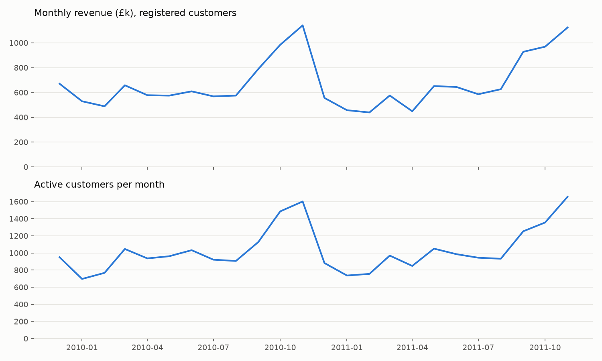
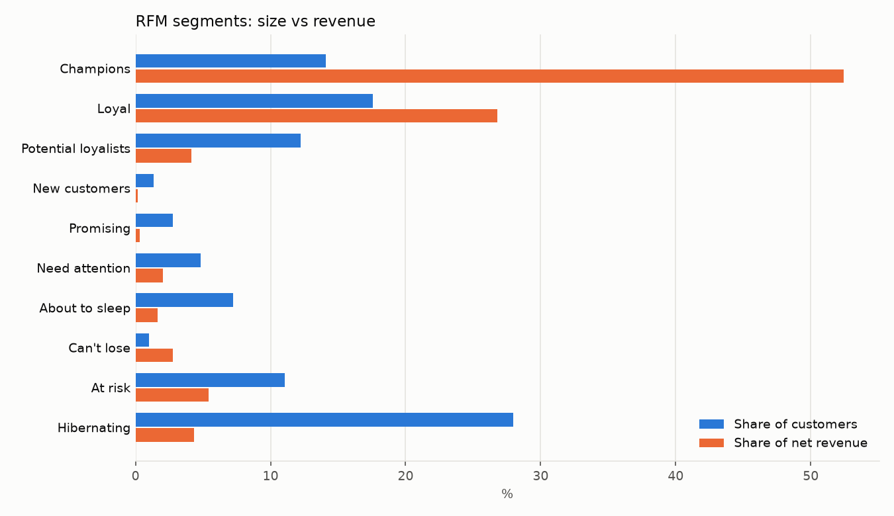
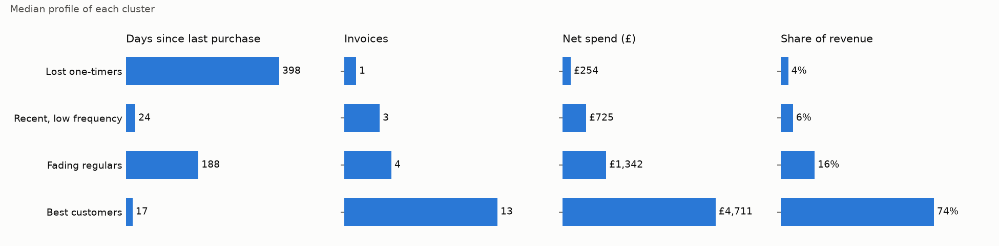
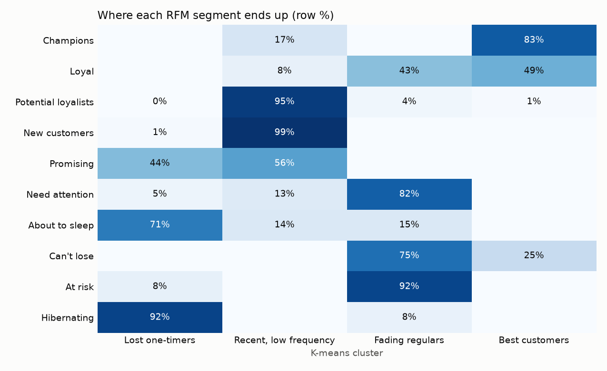
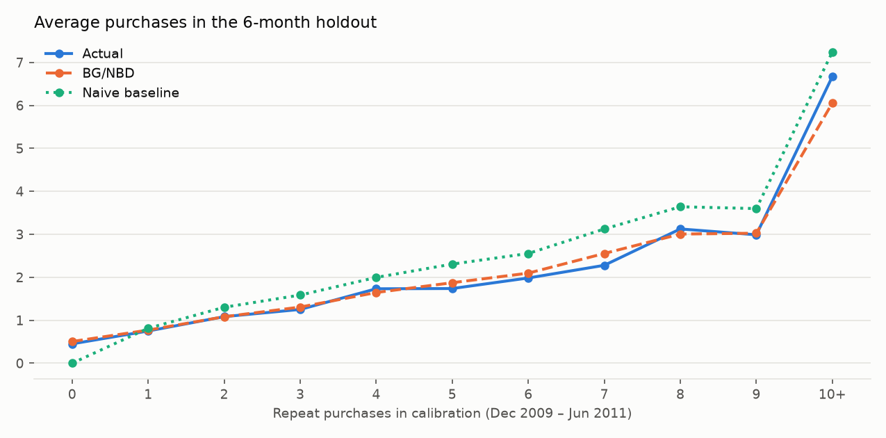
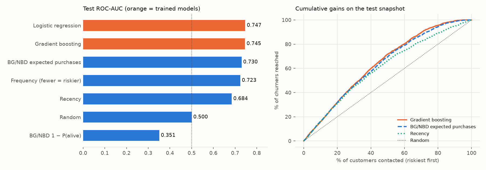
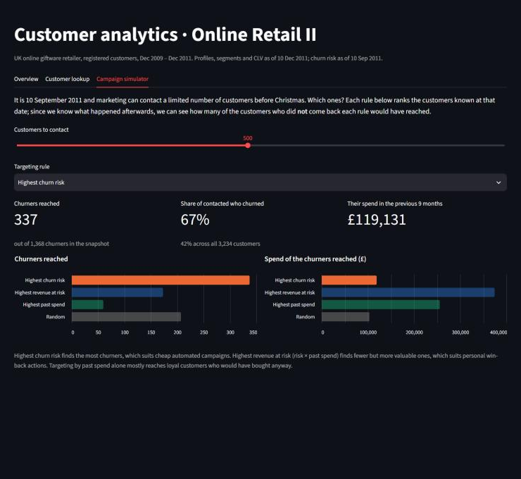

# Customer Analytics on Online Retail II

End-to-end customer analytics on two years of transactions from a UK-based online
gift retailer: data cleaning, RFM analysis, customer segmentation, Customer Lifetime
Value (BG/NBD + Gamma-Gamma) and churn prediction. Every step is motivated in the
notebooks, compared with a simple baseline where it makes sense, and validated
without using information from the future.

**Stack:** Python, pandas, scikit-learn, lifetimes, matplotlib, Jupyter.

## Key results

| Question | Answer |
|---|---|
| How concentrated is revenue? | The top 20% of customers generate **77%** of net revenue; Champions and Loyal (32% of customers) generate 79% |
| What segments are there? | K-means finds 4 groups: Best customers (21% of customers, 74% of revenue), Fading regulars, Recent low-frequency buyers, Lost one-timers. It also shows that **43% of the RFM "Loyal" customers are already fading** |
| How much will customers be worth? | BG/NBD predicts the purchases of a 6-month holdout **within 1.5%** (naive baseline +4.7%). Revenue is underestimated by 16% because pre-Christmas orders are larger and the models have no seasonality |
| Who will not come back for Christmas? | On a temporal test set, gradient boosting reaches **ROC-AUC 0.745** vs 0.730 for the best baseline (BG/NBD); a modest but significant gain (bootstrap 95% CI +0.003 to +0.027) |
| Where should the budget go? | Targeting the 500 customers with the highest *revenue at risk* instead of the highest churn risk reaches churners worth **3× more** in past revenue |

Some findings along the way that shaped the analysis:

- The two Excel sheets overlap on 9 days (22,523 identical rows), and only 34% of returns can be paired
  with the purchase they cancel, but those pairs carry 77% of the returned value.
- A Gaussian mixture is unusable on this data: the integer frequency makes the BIC reward components
  squeezed onto single values.
- BG/NBD's probability of being alive is **worse than random** as a churn score, because the model
  assumes every one-time buyer is still active.
- Pairing returns with purchases on the whole period leaks future information into churn features;
  the churn pipeline redoes the pairing at each cutoff.

## Data

[Online Retail II](https://archive.ics.uci.edu/dataset/502/online+retail+ii) (UCI Machine
Learning Repository, CC BY 4.0): ~1.07M invoice lines, Dec 2009 – Dec 2011.

The data is not versioned. Download the zip from UCI and place `online_retail_II.xlsx`
in `data/raw/`.

## 1. Data cleaning

[`notebooks/01_data_cleaning.ipynb`](notebooks/01_data_cleaning.ipynb)

| Step | Rows left | Rows removed | Customers |
|---|---:|---:|---:|
| Raw data (both sheets) | 1,067,371 | – | 5,942 |
| 1. Remove overlap between the two sheets | 1,044,848 | 22,523 | 5,942 |
| 2. Drop exact duplicate rows | 1,033,036 | 11,812 | 5,942 |
| 3. Drop lines without customer ID | 797,885 | 235,151 | 5,942 |
| 4. Drop non-positive prices | 797,815 | 70 | 5,939 |
| 5. Drop non-product codes (postage, fees, adjustments) | 794,183 | 3,632 | 5,875 |
| 6–7. Remove returns paired with the purchase they cancel | 782,137 | 12,046 | 5,862 |

Key decisions:

- **Missing customer IDs (22.8% of lines, 15% of revenue) are dropped.** IDs are missing for
  whole invoices, never for single lines, so they cannot be imputed. All customer metrics
  describe registered customers.
- **Returns are paired with the purchase they cancel and both are removed** when customer,
  product, price and quantity match exactly. Only 34% of return lines pair up, but they account
  for 77% of the returned value (large orders cancelled within minutes). Without this step a
  cancelled order would still count as a transaction in the CLV models.
- **Unpaired returns** (mostly partial) are kept in a separate table, used later for net spend
  and as a churn feature.
- **Large wholesale orders are kept**: they are real behaviour, not errors.

Result: 5,839 customers with 36,337 purchase invoices between Dec 2009 and Dec 2011.



## 2. RFM analysis

[`notebooks/02_rfm_analysis.ipynb`](notebooks/02_rfm_analysis.ipynb)

Each customer is described by **Recency** (days since last purchase), **Frequency** (number of
invoices) and **Monetary** (net spend), measured at 2011-12-10. Revenue is highly concentrated:
the top 20% of customers generate **77%** of net revenue, the top 1% generate 31%.

- Recency and monetary are scored 1–5 by quintiles.
- Frequency uses fixed thresholds (1 / 2 / 3–4 / 5–9 / 10+ invoices): 27.6% of customers have a
  single invoice, so quintiles either collapse or give identical customers different scores.
- Segments come from the standard recency × frequency grid. Monetary is left out of the grid
  because it is strongly correlated with frequency (Spearman 0.86) and is used to describe segment value.
- The RFM function takes the snapshot date as a parameter, so the churn model can recompute it at
  a past cutoff without leakage.

| Segment | Customers | % customers | % net revenue | Recommended action |
|---|---:|---:|---:|---|
| Champions | 822 | 14.1% | 52.4% | Reward: early access, loyalty perks, no discounts needed |
| Loyal | 1,027 | 17.6% | 26.8% | Upsell and cross-sell, ask for referrals |
| Potential loyalists | 715 | 12.2% | 4.2% | Build the habit: volume offers, pre-Christmas reminders |
| New customers | 77 | 1.3% | 0.2% | Onboarding and a reason to place a second order |
| Promising | 161 | 2.8% | 0.3% | Personalised recommendations |
| Need attention | 281 | 4.8% | 2.0% | Time-limited offer based on past purchases |
| About to sleep | 421 | 7.2% | 1.6% | Reactivation email before they lapse |
| Can't lose | 57 | 1.0% | 2.7% | Top-priority win-back with personal contact |
| At risk | 646 | 11.1% | 5.4% | Win-back campaign with a real incentive |
| Hibernating | 1,632 | 27.9% | 4.3% | Low-cost automated campaigns only |



## 3. Segmentation with clustering

[`notebooks/03_segmentation.ipynb`](notebooks/03_segmentation.ipynb)

K-means on the actual recency, frequency and monetary values, log-transformed (skewness of monetary
drops from 26.8 to 0.1) and standardised so that days, invoices and pounds weigh equally.

- **k = 4**: second-best silhouette after the trivial k = 2 (0.36 vs 0.34 for k = 3) and almost
  identical clusters across random seeds (adjusted Rand index 0.99).
- **Gaussian mixture rejected**: because frequency is an integer, the BIC rewards components squeezed
  onto single values ("exactly 2 invoices") and keeps falling up to k = 9. With 4 components it agrees
  only partly with k-means (ARI 0.40) and is uncertain about 29% of customers.

| Cluster | % customers | Days since last purchase | Invoices | Net spend | % revenue | Recommended action |
|---|---:|---:|---:|---:|---:|---|
| Best customers | 20.8% | 17 | 13 | £4,711 | 74.1% | Protect: account management, early access, watch for slowdowns |
| Fading regulars | 26.0% | 188 | 4 | £1,342 | 16.4% | Biggest opportunity: personalised win-back, trigger when the usual gap is exceeded |
| Recent, low frequency | 20.0% | 24 | 3 | £725 | 5.9% | Nurture towards a habit: recommendations, bundles, pre-Christmas reminders |
| Lost one-timers | 33.3% | 398 | 1 | £254 | 3.6% | Low priority: cheap automated reactivation only |

*Medians per cluster.*



**Comparison with RFM segments:** the two methods largely agree (83% of Champions are Best customers,
92% of Hibernating are Lost one-timers). The exception is the **Loyal** segment, which k-means splits
into heavy buyers still active (median 36 days, 12 invoices) and moderate buyers whose last order is
already three months old (89 days, 6 invoices): part of a segment that looks healthy in the RFM grid
is already losing the habit.



## 4. Customer Lifetime Value

[`notebooks/04_clv.ipynb`](notebooks/04_clv.ipynb)

12-month CLV = expected purchases (**BG/NBD**) × expected value per purchase (**Gamma-Gamma**),
discounted at 1% per month. CLV is in revenue, as margins are not available.

- One purchase = one customer-day; time in weeks; gross revenue (unpaired returns are 1% of revenue).
- **Validation:** fitted on 18 months (Dec 2009 – Jun 2011), tested on the following 6 months, against a
  naive baseline where each customer keeps their past repeat-purchase rate. A 12 + 12 months split was
  rejected: with one year of history the dropout parameters are not identifiable (`b` hits the
  optimiser bound and purchases are overestimated by 54%).

| Holdout (6 months) | Actual | BG/NBD | Naive baseline |
|---|---:|---:|---:|
| Repeat purchases, all customers | 7,720 | 7,606 (−1.5%) | 8,084 (+4.7%) |
| Customers silent for more than 6 months | 763 | 810 | 1,091 |
| One-time buyers | 725 | 812 | 0 |
| MAE per customer | – | 1.04 | 1.09 |
| Revenue (BG/NBD × Gamma-Gamma) | £4.28M | £3.61M (−16%) | £6.18M (+44%) |

Per customer, BG/NBD is only slightly better than the baseline; its advantage is on customers who have
gone silent and on one-time buyers, and in the total. Revenue is underestimated because of
**seasonality**: purchases in September–October are 24% larger on average, and the models assume a
constant rate and value.

Other checks: Gamma-Gamma's independence assumption holds (correlation between frequency and value 0.13);
BG/NBD treats every one-time buyer as alive, so P(alive) is not used for them (MBG/NBD gives the same
accuracy).

| Cluster | % customers | Median CLV | % of predicted CLV |
|---|---:|---:|---:|
| Best customers | 20.8% | £2,291 | 67.6% |
| Recent, low frequency | 20.0% | £822 | 14.1% |
| Fading regulars | 26.0% | £525 | 12.3% |
| Lost one-timers | 33.3% | £191 | 6.1% |

The top 20% of customers by CLV account for 71% of predicted value. CLV also exposes "false friends":
customer 17850 is in the Best customers cluster thanks to past spend, but after a year of silence, for
someone who used to buy every couple of weeks, the predicted CLV is about £3.



## 5. Churn prediction

[`notebooks/05_churn.ipynb`](notebooks/05_churn.ipynb)

**Question:** in early September, which customers will not buy during the Christmas season?
Churn = no purchase in the 3 months after the cutoff (10 Sep – 9 Dec).

| | Cutoff | Features from | Churn observed in | Customers | Churn rate |
|---|---|---|---|---:|---:|
| Train | 10 Sep 2010 | 9 months before | 10 Sep – 9 Dec 2010 | 3,241 | 41.2% |
| Test | 10 Sep 2011 | 9 months before | 10 Sep – 9 Dec 2011 | 3,234 | 42.3% |

**No leakage by design:**
- temporal split in the same season, with training labels fully observed before the test cutoff;
- the same 9-month feature window in both snapshots;
- preprocessing inside a scikit-learn `Pipeline`, hyperparameters tuned with 5-fold CV on train only,
  test set used once;
- returns re-paired with purchases using only returns made before each cutoff (the phase 1 pairing used
  the whole period and would have removed ~200–290 purchase lines per snapshot using future returns);
- outputs of phases 2–4 (computed on all 24 months) not used as features.

| Test snapshot | ROC-AUC | Average precision | Churn rate in riskiest 20% |
|---|---:|---:|---:|
| Random | 0.500 | 0.423 | 42.3% |
| Recency only | 0.684 | 0.592 | 65.5% |
| Frequency only | 0.723 | 0.585 | 59.4% |
| BG/NBD expected purchases | 0.730 | 0.615 | 66.9% |
| BG/NBD 1 − P(alive) | 0.351 | 0.401 | 36.2% |
| Logistic regression | 0.747 | 0.638 | 67.8% |
| **Gradient boosting (chosen on CV)** | **0.745** | **0.630** | **67.5%** |

- The chosen model beats the best baseline by **+0.016 AUC** (bootstrap 95% CI +0.003 to +0.027): a real
  but modest gain. Churn without a contract is hard to predict from purchase history alone.
- **1 − P(alive) is worse than random**: BG/NBD considers every one-time buyer alive, but they churn
  twice as often as repeat customers (59% vs 29%).
- Most important features (permutation importance): number of distinct products, **overdue ratio**
  (days since last purchase ÷ usual gap between purchases) and recency.
- **Targeting:** contacting the 500 riskiest customers reaches 337 churners worth £119k in past
  revenue; ranking by *revenue at risk* (risk × spend) reaches 173 churners worth £375k. The first suits
  cheap automated campaigns, the second personal win-back actions.



## 6. Dashboard

[`app/streamlit_app.py`](app/streamlit_app.py) · a Streamlit app for a marketing team, with three tabs:

- **Overview:** key figures and size vs revenue of every RFM segment or k-means cluster, with the
  recommended action for each.
- **Customer lookup:** profile, segment, cluster, 12-month CLV and probability of being active for any
  customer, plus their churn risk at 10 Sep 2011 and what actually happened. One-time buyers get a warning,
  since the CLV models know little about them.
- **Campaign simulator:** choose how many customers to contact before Christmas 2011 and how to rank them
  (churn risk, revenue at risk, past spend, random), and see how many churners each rule would have reached
  and how much they were worth.

The app reads a single customer table, `app/data/customers.parquet` (about 340 KB), built by
`app/prepare_data.py` from the notebook outputs and versioned so the dashboard runs without the raw data.



## Limitations

- **Registered customers only.** Lines without a customer ID (15% of revenue) cannot be attributed and
  are excluded from every customer-level result.
- **Revenue, not profit.** Margins are not in the data, so CLV and "revenue at risk" are in revenue terms.
- **No seasonality in the CLV models.** BG/NBD and Gamma-Gamma assume a constant buying rate and value;
  they rank customers well and get yearly totals roughly right, but they are not monthly forecasts.
- **One-time buyers.** BG/NBD treats them as alive, and their CLV is essentially a population average.
- **Short history.** Two years of data allow only one training and one test snapshot for churn; the test
  result comes from a single season.
- **Purchase history only.** Churn signal is limited without behavioural data such as website visits,
  email engagement or customer service contacts.

## What I would do next

- Add seasonality to the CLV (e.g. a seasonal adjustment of the purchase rate, or a model such as
  Pareto/GGG or a hierarchical Bayesian model with covariates).
- Collect more cutoffs as more data arrives, to train the churn model on several seasons and test it on
  more than one.
- Measure the effect of the recommended campaigns with an A/B test, which is the only way to know whether
  targeting by risk or by revenue at risk actually retains more value.

## Project structure

```
├── app/
│   ├── streamlit_app.py        # dashboard
│   ├── prepare_data.py         # builds the dashboard's customer table
│   ├── data/customers.parquet  # one row per customer (versioned)
│   └── requirements.txt        # minimal dependencies for deployment
├── data/
│   ├── raw/                    # original UCI file (not versioned)
│   └── processed/              # outputs of each notebook (not versioned)
├── notebooks/
│   ├── 01_data_cleaning.ipynb
│   ├── 02_rfm_analysis.ipynb
│   ├── 03_segmentation.ipynb
│   ├── 04_clv.ipynb
│   └── 05_churn.ipynb
├── reports/figures/            # charts used in this README
├── src/
│   ├── cleaning.py             # loading and cleaning steps
│   ├── rfm.py                  # RFM table and segments at any snapshot date
│   ├── segmentation.py         # features, k-means and evaluation helpers
│   ├── clv.py                  # BG/NBD and Gamma-Gamma inputs and fitting
│   └── churn.py                # churn dataset built at a cutoff, leakage-free
└── requirements.txt
```

## How to run

```bash
python -m venv .venv
.venv\Scripts\activate        # on macOS/Linux: source .venv/bin/activate
pip install -r requirements.txt
```

Place `online_retail_II.xlsx` in `data/raw/`, then run the notebooks in order (each one reads the
outputs of the previous ones from `data/processed/`). From the `notebooks/` folder:

```bash
jupyter nbconvert --to notebook --execute --inplace 01_data_cleaning.ipynb 02_rfm_analysis.ipynb 03_segmentation.ipynb 04_clv.ipynb 05_churn.ipynb
```

Random seeds are fixed: re-running all five notebooks from scratch reproduces every output table exactly.
The full run takes a few minutes, most of it reading the Excel file and tuning the churn models.

To launch the dashboard from the project root (the customer table is already in the repository; rebuild it
with `python app/prepare_data.py` after re-running the notebooks):

```bash
streamlit run app/streamlit_app.py
```
